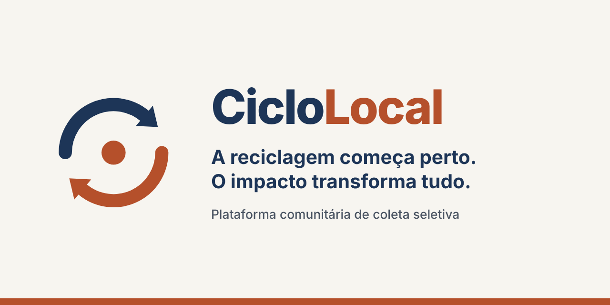

# CicloLocal



**A reciclagem começa perto. O impacto transforma tudo.**

O **CicloLocal** é uma plataforma web de inteligência comunitária para reciclagem. A proposta é aproximar moradores que desejam destinar materiais recicláveis de coletores da região, organizar os pedidos por bairro e transformar as coletas concluídas em indicadores de impacto para a comunidade.

Projeto desenvolvido como Trabalho de Conclusão de Curso com **HTML5, CSS3 e JavaScript puro**, sem frameworks, backend ou banco de dados.

- **Aplicação publicada:** https://gabeqrz.github.io/ciclo-local/
- **Repositório:** https://github.com/gabeqrz/ciclo-local

---

## Sumário

- [Como funciona](#como-funciona)
- [Funcionalidades implementadas](#funcionalidades-implementadas)
- [Telas e fluxo](#telas-e-fluxo)
- [Tecnologias e integrações](#tecnologias-e-integrações)
- [Dados e limitações](#dados-e-limitações)
- [Estimativa de impacto ambiental](#estimativa-de-impacto-ambiental)
- [Acessibilidade](#acessibilidade)
- [Como executar localmente](#como-executar-localmente)
- [Estrutura do projeto](#estrutura-do-projeto)
- [Documentação e próximos passos](#documentação-e-próximos-passos)

## Como funciona

O CicloLocal organiza a experiência em três partes:

1. **Doador:** informa o endereço, seleciona os materiais disponíveis e estima seus pesos. O pedido fica disponível para os coletores da região.
2. **Coletor:** consulta os pedidos, filtra por bairro, aceita uma coleta e, depois de realizá-la, confirma os pesos efetivamente recolhidos.
3. **Comunidade:** acompanha os resultados das coletas concluídas em um painel com indicadores, histórico e estimativas de impacto ambiental.

O fluxo de uma coleta possui três estados:

`esperando` → `aceita` → `concluida`

**Regra dos indicadores:** um pedido criado ou aceito ainda não representa material coletado. Os totais do painel consideram apenas coletas concluídas e os pesos confirmados pelo coletor.

### Proposta de valor

O diferencial do CicloLocal é colocar a comunidade no centro da experiência: a atividade é organizada por bairro, o coletor encontra oportunidades de coleta e os moradores podem acompanhar os resultados coletivos. A plataforma complementa iniciativas existentes; não substitui serviços municipais nem garante que todo pedido será atendido.

## Funcionalidades implementadas

### Para quem doa

- Consulta de endereço pelo CEP, com preenchimento automático via ViaCEP.
- Seleção entre sete categorias de materiais recicláveis.
- Escolha de peso por material e cálculo automático do total estimado.
- Validação dos campos necessários antes do envio.
- Registro do pedido e tela de confirmação com acompanhamento do andamento.

### Para quem coleta

- Listagem de pedidos disponíveis na cidade selecionada.
- Filtro de pedidos por bairro.
- Aceite de uma coleta e visualização do endereço completo após o aceite.
- Possibilidade de desfazer o aceite enquanto a coleta não foi concluída.
- Confirmação da coleta com registro do peso efetivamente recolhido por material.
- Opção de desistir de uma coleta aceita.

### Histórico e resultados

- Histórico de coletas concluídas.
- Filtros do histórico por mês e bairro, com exibição progressiva dos registros.
- Dashboard com indicadores de peso recolhido, coletas realizadas, pessoas participantes e pedidos aguardando atendimento.
- Indicadores por material, evolução mensal e ranking de bairros.
- Filtro de visualização por bairro.
- Estimativa de CO₂ equivalente evitado com base nos materiais e pesos confirmados.
- Impressão do painel, com opção de salvar como PDF pelo navegador.

### Localização

- Solicitação de localização do dispositivo, mediante permissão do usuário.
- Identificação aproximada da cidade a partir das coordenadas.
- Alternativa para selecionar manualmente estado e cidade.
- Persistência da cidade escolhida durante o uso da demonstração.

## Telas e fluxo

| Etapa | Arquivo | Responsabilidade |
|---|---|---|
| 1 | `index.html` | Página inicial e entrada demonstrativa |
| 2 | `selecao-de-perfil.html` | Escolha entre os perfis de doador e coletor |
| 3A | `perfil-doador.html` | Endereço, materiais e pesos estimados |
| 4A | `confirmacao-doador.html` | Resumo do pedido e acompanhamento |
| 3B | `perfil-coletor.html` | Consulta, filtro e aceite de pedidos |
| 4B | `confirmacao-coletor.html` | Coletas aceitas, conclusão e histórico do coletor |
| 5 | `historico-coletas.html` | Histórico geral com filtros por mês e bairro |
| 6 | `dashboard.html` | Indicadores e resultados da reciclagem |

**Materiais disponíveis:** cobre, alumínio, PET, outros plásticos, papel branco, papelão e garrafas e potes de vidro.

## Tecnologias e integrações

| Tecnologia ou serviço | Uso |
|---|---|
| HTML5 | Estrutura semântica das páginas e formulários |
| CSS3 | Identidade visual, responsividade, Flexbox, Grid e impressão |
| JavaScript (ES Modules) | Fluxos, validações, manipulação do DOM, eventos e cálculos |
| `localStorage` | Persistência local de pedidos, coletas, histórico e preferências |
| [ViaCEP](https://viacep.com.br/) | Consulta de endereço pelo CEP |
| [API de localidades do IBGE](https://servicodados.ibge.gov.br/api/docs/localidades) | Carregamento de estados e municípios |
| [Nominatim / OpenStreetMap](https://nominatim.org/) | Conversão das coordenadas em uma cidade aproximada |
| Google Fonts | Família tipográfica Plus Jakarta Sans |

O projeto utiliza módulos JavaScript nativos e não depende de bibliotecas ou frameworks de interface.

## Dados e limitações

O CicloLocal é um protótipo front-end. Para permitir a navegação e a demonstração dos indicadores, o sistema inicializa registros fictícios quando não encontra um estado salvo no navegador.

- Os dados de demonstração são identificados na interface e não representam registros reais.
- Pedidos e alterações são armazenados no `localStorage` do próprio navegador.
- Os dados não são enviados a um servidor nem sincronizados entre dispositivos ou navegadores.
- A demonstração possui dados de referência para **São Paulo - SP**. Selecionar outra cidade não cria automaticamente uma base real para ela.
- A entrada no estilo gov.br é demonstrativa: não há autenticação oficial, integração com o Login Único nem coleta de credenciais reais.
- A geolocalização depende da permissão do navegador e da disponibilidade dos serviços externos.

Para reiniciar a demonstração e restaurar os dados iniciais, abra o Console do navegador e execute:

```js
reiniciarDemo()
```

A função remove o estado salvo no `localStorage` e recarrega a página. Não existe um botão de reinicialização exposto na interface.

**Limite central da versão atual:** como não há backend nem banco de dados, doador e coletor precisam utilizar o mesmo navegador e dispositivo para compartilhar o estado da demonstração.

## Estimativa de impacto ambiental

O módulo `js/esg.js` calcula uma estimativa de emissões de gases de efeito estufa evitadas a partir do peso confirmado de cada material. A referência metodológica utilizada é o **Waste Reduction Model (WARM), versão 16**, da Agência de Proteção Ambiental dos Estados Unidos (EPA).

Os fatores estão expressos no código como quilogramas de CO₂ equivalente (kg CO₂e) estimados por quilograma de material:

| Categoria no CicloLocal | Fator (kg CO₂e/kg) |
|---|---:|
| Cobre | 4,95 |
| Alumínio | 7,94 |
| PET | 1,15 |
| Outros plásticos | 1,03 |
| Papel branco | 3,15 |
| Papelão | 3,46 |
| Garrafas e potes de vidro | 0,31 |

O cálculo aplicado é:

```text
Impacto estimado (kg CO₂e) =
soma do peso confirmado de cada material × seu fator correspondente
```

Exemplo: 2 kg de PET e 5 kg de papelão:

```text
(2 × 1,15) + (5 × 3,46) = 19,60 kg CO₂e
```

**Importante:** trata-se de uma estimativa baseada em fatores de referência dos Estados Unidos, não de uma medição direta das emissões evitadas no município. As categorias do projeto são associadas às categorias de materiais disponíveis na metodologia de referência. Os resultados podem variar conforme composição, origem, transporte, processamento e destinação efetiva dos materiais. Portanto, devem ser apresentados como estimativas, e não como impacto ambiental medido.

Referências:
- [EPA — documentação dos fatores e capítulos do WARM](https://www.epa.gov/waste-reduction-model/documentation-chapters-emissions-energy-and-economic-factors-used-waste)
- [EPA — versões do Waste Reduction Model](https://www.epa.gov/waste-reduction-model/versions-waste-reduction-model)

## Acessibilidade

A acessibilidade é uma diretriz de desenvolvimento do CicloLocal. O projeto adota como referência as **Diretrizes de Acessibilidade para Conteúdo Web (WCAG) 2.2, nível AA**.

Entre os aspectos considerados estão:

- HTML semântico e associação entre rótulos e campos de formulário.
- Navegação por teclado e indicação visual de foco.
- Mensagens de validação e atualizações de conteúdo com recursos de acessibilidade.
- Contraste, legibilidade, alvos de interação e adaptação a telas menores.
- Respeito à preferência do sistema por redução de movimento nos elementos animados.

A auditoria de acessibilidade permanece em andamento. A referência WCAG 2.2 AA representa uma meta de projeto, **não uma declaração de conformidade ou certificação**. Os critérios precisam ser verificados continuamente com ferramentas automatizadas e testes manuais, incluindo teclado, leitor de tela, zoom e diferentes larguras de tela.

## Como executar localmente

Como o projeto utiliza módulos JavaScript, execute-o por meio de um servidor local.

1. Faça o clone do repositório:

   ```bash
   git clone https://github.com/gabeqrz/ciclo-local.git
   ```

2. Abra a pasta `ciclo-local` no Visual Studio Code.
3. Inicie a extensão **Live Server** a partir do arquivo `index.html`.
4. Acesse o endereço local fornecido pela extensão.

Não é recomendado abrir o HTML diretamente pelo sistema de arquivos (`file://`), pois o navegador pode bloquear o carregamento dos módulos JavaScript.

## Estrutura do projeto

```text
ciclo-local/
├── index.html
├── selecao-de-perfil.html
├── perfil-doador.html
├── confirmacao-doador.html
├── perfil-coletor.html
├── confirmacao-coletor.html
├── historico-coletas.html
├── dashboard.html
│
├── reset.css
├── tokens.css
├── style.css
├── preloader.css
├── print.css
│
├── js/
│   ├── app.js
│   ├── cep.js
│   ├── confirmacao-coletor.js
│   ├── confirmacao-doador.js
│   ├── dados.js
│   ├── dashboard.js
│   ├── esg.js
│   ├── filtro-bairro.js
│   ├── historico-coletas.js
│   ├── local.js
│   ├── perfil-coletor.js
│   ├── perfil-doador.js
│   ├── preloader.js
│   ├── resultados.js
│   ├── storage.js
│   └── util.js
│
├── img/
│   ├── apple-touch-icon.png
│   ├── cicloLocal-simbolo.svg
│   ├── favicon.svg
│   ├── logo-ciclolocal.svg
│   ├── previa-github-1280x640.png
│   ├── previa-social-1200x630.png
│   └── icones/
│
└── docs/
    ├── CicloLocal-documento-unificado-v2.1.pdf
    ├── IMPLEMENTACOES-FUTURAS.md
    ├── identidade-visual/
    ├── planejamento/
    │   └── CicloLocal-roadmap-de-execucao-v2.1.pdf
    └── prototipos/
        └── CicloLocal — Mockup da jornada do usuário.pdf
```

### Organização dos módulos JavaScript

| Módulo | Responsabilidade |
|---|---|
| `app.js` | Inicialização compartilhada e função de reinício da demonstração |
| `cep.js` | Máscara, validação e consulta de CEP |
| `dados.js` | Dados e categorias de materiais |
| `storage.js` | Leitura, atualização e persistência do estado local |
| `util.js` | Funções utilitárias compartilhadas |
| `local.js` | Geolocalização e seleção manual de cidade |
| `perfil-doador.js` | Formulário e criação de pedidos |
| `perfil-coletor.js` | Listagem, filtro e aceite de pedidos |
| `confirmacao-doador.js` | Resumo e acompanhamento do pedido |
| `confirmacao-coletor.js` | Confirmação, conclusão e desistência de coletas |
| `historico-coletas.js` | Filtros e apresentação do histórico |
| `dashboard.js` | Renderização dos indicadores e filtros do painel |
| `resultados.js` | Consolidação dos resultados da reciclagem |
| `esg.js` | Estimativa de impacto ambiental |
| `filtro-bairro.js` | Componente de filtro por bairro |
| `preloader.js` | Comportamento da tela de carregamento |

## Documentação e próximos passos

Materiais complementares disponíveis no repositório:

- [Documento unificado do projeto](./docs/CicloLocal-documento-unificado-v2.1.pdf)
- [Roadmap de execução](./docs/planejamento/CicloLocal-roadmap-de-execucao-v2.1.pdf)
- [Mockup da jornada do usuário](./docs/prototipos/CicloLocal%20%E2%80%94%20Mockup%20da%20jornada%20do%20usu%C3%A1rio.pdf)
- [Implementações futuras](./docs/IMPLEMENTACOES-FUTURAS.md)

Entre as evoluções previstas estão:

- Mapa com marcadores por bairro e visualizações gráficas complementares.
- Visões específicas para doador e coletor.
- Selos, metas e recursos de incentivo à participação.
- Link para ecopontos e filtros adicionais.
- Banco de dados e sincronização entre dispositivos.
- Autenticação real, caso seja possível integrar o Login Único do gov.br dentro dos requisitos técnicos e institucionais.
- Notificações de atualização dos pedidos.
- Pesquisa de fatores de impacto ambiental adequados à realidade brasileira.

O escopo de cada melhoria deve ser avaliado conforme os objetivos acadêmicos, a disponibilidade de fontes confiáveis e a evolução técnica do projeto.

---

_Projeto acadêmico desenvolvido como Trabalho de Conclusão de Curso. Os registros de demonstração são fictícios._
