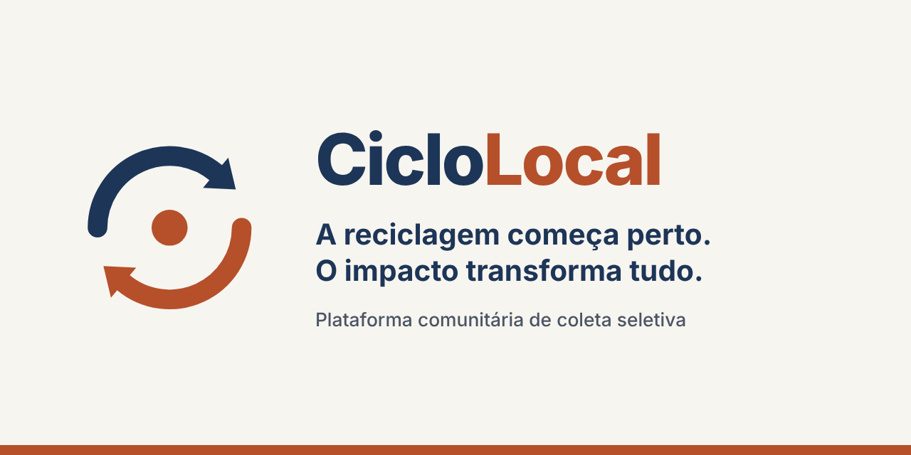

# CicloLocal



**A reciclagem começa perto. O impacto transforma tudo.**

O CicloLocal é uma plataforma web de **inteligência comunitária para reciclagem**. Ela aproxima moradores que têm material reciclável de coletores da região, organiza os pedidos por bairro e mostra os resultados da comunidade em um painel público.

Projeto de TCC feito só com **HTML, CSS e JavaScript puro**, sem backend, sem banco de dados e sem bibliotecas.

> **Site publicado:** https://gabeqrz.github.io/ciclo-local/

---

## O que o projeto faz

- **Doador:** informa o CEP, marca os materiais que tem e escolhe o peso aproximado. O pedido fica disponível para os coletores do bairro.
- **Coletor:** vê os pedidos esperando, filtra por bairro e aceita uma coleta. O endereço completo só aparece depois do aceite. Depois de recolher, marca a coleta como concluída e confirma o peso de cada material.
- **Resultados da reciclagem:** um painel público, aberto sem entrar, com meta do mês, quilos recolhidos, coletas feitas, pessoas participando, evolução mês a mês, comparação entre bairros e CO₂ estimado que deixou de ir para o ar.

**Regra de ouro:** pedido publicado ou aceito não é material coletado. Só entram nos totais as coletas **concluídas**, com o peso confirmado pelo coletor.

### Diferencial

Já existem soluções que conectam quem gera recicláveis a catadores. O CicloLocal coloca a **comunidade no centro**: organiza a atividade por bairro, mostra a evolução coletiva e reúne os registros individuais em um painel de impacto. Ele complementa iniciativas existentes. Não substitui serviços municipais nem garante que todo pedido será atendido.

## Alinhamento ESG

| Eixo | Como aparece no projeto |
|---|---|
| **E** Ambiental | Cada quilo confirmado deixou de seguir para o lixo comum. O painel estima o CO₂ evitado por tipo de material. |
| **S** Social | Pedidos organizados por bairro, material e peso dão previsibilidade ao coletor. O histórico registra o trabalho feito. A interface usa palavras simples, é mobile-first e acessível. |
| **G** Governança | Painel público com fonte do cálculo sempre citada, status do pedido (esperando, aceita, concluída) e dados de exemplo sempre identificados. |

**O que o projeto não promete:** aumento de renda medido, o destino final do material ou o atendimento garantido de todos os pedidos.

---

## Telas e fluxo

| Tela | Arquivo | O que faz |
|---|---|---|
| 1 | `index.html` | Boas-vindas e entrada simulada com gov.br |
| 2 | `selecao-de-perfil.html` | Escolha entre doar recicláveis ou recolher materiais |
| 3A | `perfil-doador.html` | CEP, número, materiais e peso aproximado |
| 4A | `confirmacao-doador.html` | Pedido enviado, andamento em 3 passos e link para os resultados |
| 3B | `perfil-coletor.html` | Pedidos esperando, filtro por bairro e "Aceitar coleta" |
| 4B | `confirmacao-coletor.html` | Coletas em aberto, histórico e "Marcar como concluída" com o peso confirmado |
| 5 | `dashboard.html` | Resultados da reciclagem |

**Status do pedido:** `esperando` → `aceita` → `concluida`.

**Materiais (7):** cobre, alumínio, PET, outros plásticos, papel branco, papelão e garrafas e potes de vidro. O peso é escolhido em números fechados, a partir de 0,5 kg.

## Como rodar

1. Clone o repositório.
2. Abra a pasta no VS Code e use a extensão **Live Server** (abrir o arquivo direto, sem servidor, pode bloquear partes do JavaScript).
3. Abra `index.html`.

Na primeira abertura o app cria **dados de exemplo** (inventados) de 6 meses e 7 bairros, com o selo "Modo demonstração". No painel há os botões "Recomeçar exemplos" e "Começar do zero".

> **Limite importante:** os dados ficam no `localStorage`, só no navegador do aparelho. Um pedido criado em um celular não aparece em outro. Na apresentação, use um único aparelho. O login com gov.br é **simulado**: nenhum dado real é pedido ou guardado.

## Estrutura de pastas

```
ciclo-local/
├── index.html
├── selecao-de-perfil.html
├── perfil-doador.html
├── confirmacao-doador.html
├── perfil-coletor.html
├── confirmacao-coletor.html
├── dashboard.html
├── reset.css · tokens.css · style.css
├── preloader.css · print.css
├── js/
│   ├── app.js          sessão simulada e modo demonstração
│   ├── preloader.js    tela de carregamento (só no login)
│   ├── storage.js      localStorage e dados de exemplo
│   ├── esg.js          cálculo de impacto e CO₂
│   ├── cep.js          busca de CEP (ViaCEP)
│   └── login · selecao · doador · coletor
│       confirmacao-doador · confirmacao-coletor · dashboard
└── img/                logo, favicon, prévias sociais e icones/
```

## Tecnologias

- **HTML5, CSS3 e JavaScript puro**, mobile-first.
- **[ViaCEP](https://viacep.com.br):** o doador digita o CEP e o bairro e a cidade vêm sozinhos. Se a busca falhar, ele digita o endereço.
- **localStorage e sessionStorage:** dados da demonstração e sessão simulada.
- **Google Fonts:** Plus Jakarta Sans.

## Cálculo de CO₂ evitado

Fatores em `js/esg.js`, da **EPA WARM v16 (EUA)**, publicados pela Recycled Materials Association. Os valores originais (toneladas métricas de CO₂ equivalente por tonelada curta) foram convertidos para kg de CO₂ por kg de material, multiplicando por 1,1023.

| Material | Fator (kg de CO₂ por kg) |
|---|---|
| Cobre | 4,95 |
| Alumínio | 7,94 |
| PET | 1,15 |
| Outros plásticos | 1,03 |
| Papel branco | 3,15 |
| Papelão | 3,46 |
| Garrafas e potes de vidro | 0,31 |

Exemplo: 2 kg de PET + 5 kg de papelão = 2 × 1,15 + 5 × 3,46 = **19,6 kg de CO₂**.

São valores dos EUA, no cenário máximo. Por isso o app mostra sempre "valor estimado".

## Identidade visual

Direção **"Industrial Orgânico"**: fundo areia, azul-petróleo para o texto e terracota para as ações. Cores, fontes e espaçamentos ficam em `tokens.css`; use sempre as variáveis (`--cor-*`, `--esp-*`, `--fs-*`).

| Nome | Código | Uso |
|---|---|---|
| Areia | `#F7F5F0` | Fundo |
| Petróleo | `#1D3557` | Texto e títulos |
| Terracota 600 | `#B5502B` | Botões e links |
| Terracota 400 | `#D96B43` | Só decorativo e texto grande |

## Acessibilidade

- Meta: **WCAG 2.1 AA**.
- Link "Pular para o conteúdo" em todas as páginas.
- Navegação completa por teclado, com foco visível.
- Contraste mínimo de 4,5:1 no texto normal.
- Alvos de toque de pelo menos 44 px.
- HTML semântico: `label` em todos os campos, `fieldset` nos grupos, `aria-live` onde o texto muda e `aria-current` no menu.
- Linguagem simples, para qualquer nível de instrução.

## Como contribuir (equipe)

- A branch principal é protegida: **toda mudança entra por Pull Request** aprovado pelo responsável técnico.
- Uma branch por tarefa: `feature/nome-da-funcionalidade` ou `fix/nome-do-bug`.
- Mensagens de commit: `feat:`, `fix:`, `docs:`, `style:` ou `refactor:`, seguidas de uma descrição clara.

```bash
git checkout main
git pull origin main
git checkout -b feature/minha-tarefa
# ...trabalhe e confira com git status...
git add .
git commit -m "feat: descrição clara do que foi feito"
git push origin feature/minha-tarefa
```

Depois, abra o Pull Request no GitHub.

## Roadmap (4 semanas)

| Semana | Foco |
|---|---|
| 1 | Base e identidade: repositório, HTML semântico das 7 telas e CSS mobile-first |
| 2 | Entrada e doador: login simulado, perfil, ViaCEP e pedido salvo |
| 3 | Coletor e resultados: aceitar e concluir coletas, cálculo de impacto e painel |
| 4 | Acabamento: PDF, acessibilidade, Lighthouse, PWA, publicação e ensaio |

## Próximos passos

- Mapa (Leaflet), gráficos (Chart.js) e três visões do painel (bairro, doador e coletor).
- Selos, ranking de bairros e link para ecoponto.
- **Com servidor:** banco de dados para sincronizar aparelhos, login real com gov.br e notificações.
- Fatores de CO₂ brasileiros.

## Equipe

| Nome | Frente |
|---|---|
| Gabe Queiroz | Líder técnico / arquitetura |
| _preencher_ | Frontend e UI |
| _preencher_ | Frontend e UI |
| _preencher_ | Lógica e integrações |
| _preencher_ | Lógica e integrações |
| _preencher_ | UX, acessibilidade e documentação |

## Créditos

- Fatores de CO₂: EPA WARM v16, via Recycled Materials Association.
- Busca de CEP: ViaCEP.
- Fonte: Plus Jakarta Sans, pelo Google Fonts.

---

_Projeto acadêmico (TCC). Os dados de demonstração são fictícios._
